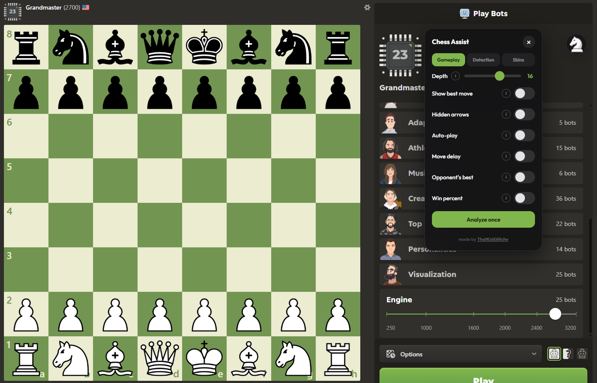

# Chess Assist

Stockfish chess engine hack for chess.com. Desktop and mobile versions included.



## Install

### Tampermonkey (recommended)

Install from Greasy Fork or directly from GitHub:

- **Desktop:** [chess-assist-tampermonkey.js](https://raw.githubusercontent.com/ThatKidGlitchy/chess-hacks/main/chess-assist-tampermonkey.js)
- **Mobile:** [chess-assist-tampermonkey-mobile.js](https://raw.githubusercontent.com/ThatKidGlitchy/chess-hacks/main/chess-assist-tampermonkey-mobile.js)

Open the raw link with Tampermonkey installed and it will offer to install the script. Updates automatically.

### Chrome Extension

Download the latest `chess-assist-extension.zip` from releases, unzip, and load as an unpacked extension at `chrome://extensions` with Developer mode on.

### Bookmarklet

See below under each version for the bookmarklet loader URL.

## Desktop (chess-assist.js)

**Features:** Stockfish 19 WASM engine, adjustable depth (1–24, default 16), best-move green arrow, hidden arrows (subtle shading), auto-play with anti-repetition, move delay (random human-like timing), opponent's best move (red arrow, works on both turns), live win% eval bar, live engine detection (opponent cheat detector), custom piece/board/tile skins, auto queen promotion, customizable keybinds for all toggles, info tooltips, tabbed UI (Gameplay / Detection / Skins), draggable panel + icon, thinking indicator, hide all mode, MultiPV 3.

### Usage — Loader Bookmarklet (recommended)

Always runs the latest version from GitHub:

1. Create a bookmark in your browser with this URL:
   ```
   javascript:void(fetch('https://raw.githubusercontent.com/ThatKidGlitchy/chess-hacks/main/chess-assist.js').then(r=>r.text()).then(eval))
   ```
2. Open a game on chess.com, click the bookmarklet
3. Click the knight icon to open the panel

### Alternative — paste in console

1. Open a game on chess.com
2. Open browser DevTools (F12 → Console)
3. Paste the contents of `chess-assist.js` and press Enter
4. Click the knight icon to open the panel

### Gameplay Tab

- **Depth slider** — engine search depth (1–24, default 16). Higher = stronger but slower
- **Show best move** — green arrow on the board showing the engine's top pick
- **Hidden arrows** — subtle square shading instead of visible arrow (opacity 0.07). Overrides green arrow when both are on
- **Auto-play** — plays the best move automatically each turn with anti-repetition to avoid draw loops
- **Move delay** — toggle on to add a random delay before auto-play moves (min/max sliders, 0–15s). Makes it look like a human thinking
- **Opponent's best** — red arrow (#e04040) showing the opponent's best reply to the current position. Shows on both your turn and the opponent's turn
- **Analyze once** — one-shot analysis without enabling continuous mode. Respects hidden arrows mode
- **Win% eval bar** — vertical bar next to the panel showing live win probability. White fill = white's advantage, updates every position change. Flips when playing as black. Uses a logistic model (centipawn → win%) from Stockfish evaluation
- **Hide all** — hides the entire UI, arrows, shading, and pauses auto-play. Press keybind again to restore everything
- **Keybinds** — click the key badge next to any toggle to assign a hotkey. Supports single keys, modifier combos (Ctrl+G), and modifier-only binds (just Ctrl). Live preview while recording, click away or Escape to cancel. No duplicates allowed
- **Info tooltips** — click the (i) icon next to any toggle to see what it does
- **Pawn promotion** — automatically promotes to queen when a pawn reaches the last rank

### Detection Tab

- **Engine detection** — tracks average centipawn loss (ACPL) in real-time. Compares engine evaluation before and after each move
- **Opponent / You toggle** — switch between tracking the opponent's accuracy or your own. Full move history is kept for both sides so switching is instant
- **Stats** — moves analyzed, average CPL, best move rate, Lichess-style accuracy
- **Suspicion gauge** — multi-factor score adjusted for ELO: Likely clean → Somewhat suspicious → Highly suspicious → Engine detected
- **Re-analyze game** — replays all recorded moves through the engine from the start, recalculating every CPL value. Use after switching target or if stats look off
- **Reset button** — clear stats for a new game

### Skins Tab

- **Custom piece skins** — click any piece tile (white/black king, queen, rook, bishop, knight, pawn) to upload a custom image. Click the × to remove
- **Board BG** — upload a custom board background image
- **Light/Dark tiles** — upload separate images for light and dark squares. Uses a `repeating-conic-gradient` CSS mask to apply the image only to the correct squares
- **Piece mask mode** — toggle to use the original piece shape as a mask filled with your custom image. For tiles: each square gets the image individually (12.5% 12.5%) instead of one large image showing through (cover)
- **Reset all skins** — clear all custom skins at once
- All skins persist in localStorage across sessions

## Mobile / iOS Safari (chess-assist-mobile.js)

Same features as desktop (including skins, live win% eval bar and engine detection) except no keybind system and no hide-all toggle (mobile doesn't use keyboards). Touch-optimized with larger targets (48px bubble, 28px switches, 22px slider thumbs), close button on panel, slightly longer timeouts for slower devices.

### Usage — Loader Bookmarklet (recommended)

Always runs the latest version from GitHub:

1. Create a bookmark in Safari with this URL:
   ```
   javascript:void(fetch('https://raw.githubusercontent.com/ThatKidGlitchy/chess-hacks/main/chess-assist-mobile.js').then(r=>r.text()).then(eval))
   ```
2. Open a chess.com game in Safari, tap the bookmarklet
3. Tap the knight icon to open the panel

### Alternative — paste in console

On desktop Safari or any browser with console access, paste the contents of `chess-assist-mobile.js` directly.

## Engine

Both versions use Stockfish 19 WASM (lite single-threaded build) loaded from unpkg CDN. Falls back to ASM.js if WASM is unavailable. MultiPV 3 with anti-repetition logic to avoid draw loops.

## Arrow Colors

| Arrow | Color | Meaning |
|-------|-------|---------|
| Green | #96bc4b | Your best move |
| Red | #e04040 | Opponent's best reply |

## Notes

- Works on chess.com only (relies on chess.com DOM structure)
- The script runs entirely client-side — no data sent anywhere
- Use the loader bookmarklet to always get the latest version automatically
- Both arrow types can be shown simultaneously (different SVG layers)
- Thank you "Chess helper (chess.com)" on the Chrome web store for the UI theme!
